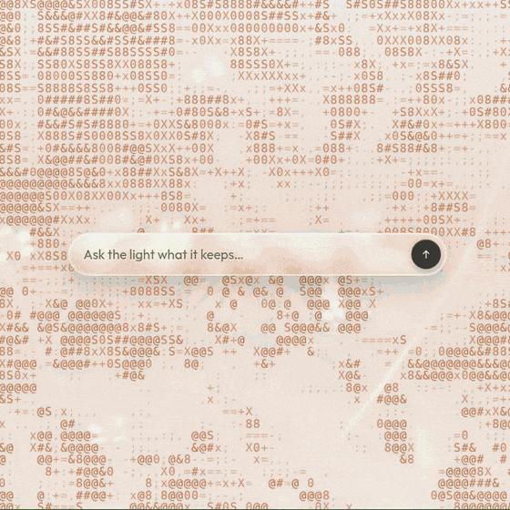

# Aster

ASCII & Dither wallpaper generator.

Turn any photo into a living ASCII wallpaper.

Aster is an open-source wallpaper generator in the browser. Choose a built-in looping wallpaper or upload your own photo, and it is redrawn as moving characters. Switch between ASCII and dither, pick a palette, and save a PNG.

**[Open the live demo](https://victoriawu-77.github.io/ascii-wallpaper/)**

[](media/aster-demo.mp4)

Looping preview of the generator. [Watch the full video](media/aster-demo.mp4) (1080×1080, with sound), or [open the live demo](https://victoriawu-77.github.io/ascii-wallpaper/).

## Features

- Upload your own photo, or drop an image or video onto the window
- ASCII and dither looks, each with its own settings
- Palettes: Original, Meadow, Blue, Amber, Lavender, and Mono
- One-click PNG export of the current frame
- Video wallpapers that keep moving: Meadow and Monarch loop; Portrait, Horizon, and Waves are stills
- Mobile-friendly layout
- Open source — the generator is this repository

## How it works

A wallpaper is sampled in the browser and drawn onto a canvas, either as ASCII glyphs or as ordered dither. Meadow starts as a field of flowers; Monarch is a butterfly loop. Your file replaces the built-in source with one image or video.

ASCII and dither remember their own palette, strength, and size. Save PNG downloads the frame on screen. Copy link writes the look into the address bar, so opening that URL restores the filter, palette, strength, and size.

## Run locally

```bash
npm install
npm run dev
```

The dev server serves the app from the site root. To build and preview the static site:

```bash
npm run build
npm run preview
```

`npm run build` typechecks and writes `dist/`. The Vite base is relative (`./`), so the same build works at `/ascii-wallpaper/` and at the site root.

## Deploy

GitHub Pages serves the `gh-pages` branch from the repository root. The live site is [victoriawu-77.github.io/ascii-wallpaper](https://victoriawu-77.github.io/ascii-wallpaper/).

Publish a build by copying `dist/` onto `gh-pages`. `public/.nojekyll` is included in that build so GitHub Pages does not pass the site through Jekyll.

## License

This repository does not include a license file yet. Until one is added, all rights are reserved.
